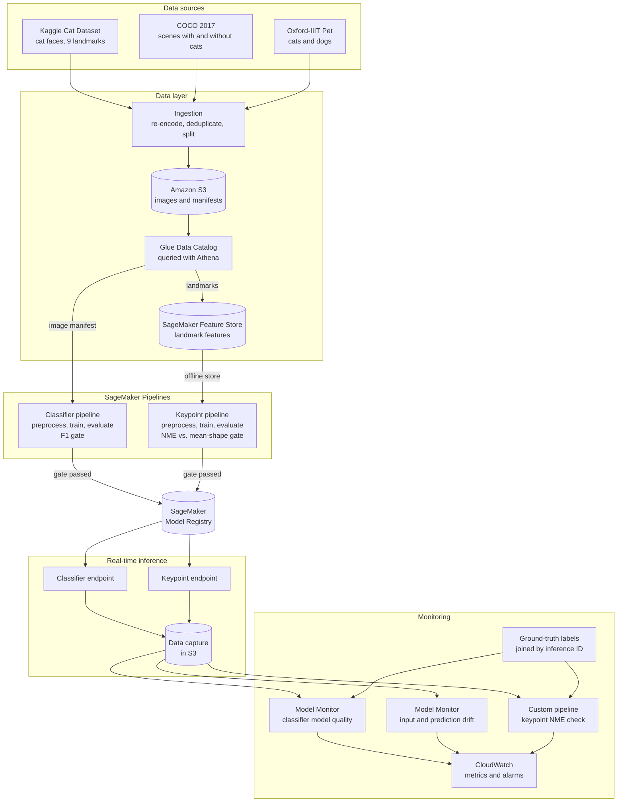
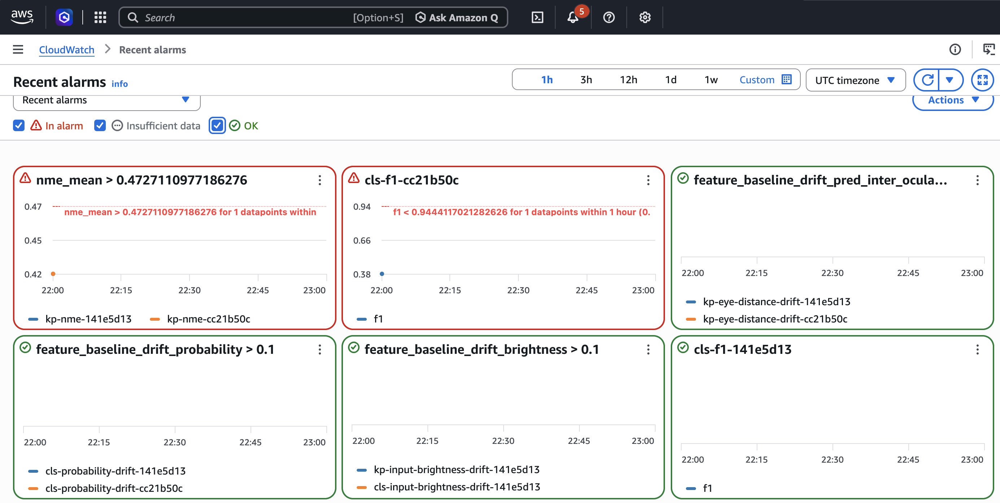
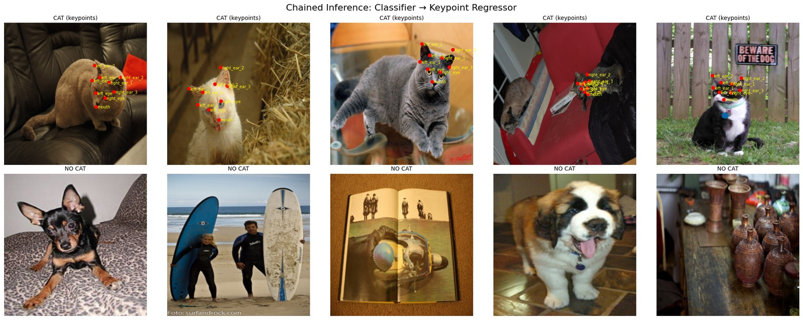

# SageMaker MLOps Pipeline: Cat Detection and Facial Keypoint Regression

> **Scope:** Graduate coursework, built by a two-person team for AAI 540 (Machine Learning Operations) in the University of San Diego M.S. in Applied Artificial Intelligence program, January–February 2026, and substantially extended afterwards (see [Team and my contributions](#team-and-my-contributions)). It ran in a single AWS account as a learning project, not a production system.

An end-to-end machine learning operations pipeline on AWS SageMaker, from raw images to monitored real-time endpoints. It serves two models:

- a **binary image classifier** that decides whether a photo contains a cat;
- a **keypoint regression model** that locates nine facial landmarks on a cat: both eyes, the mouth and three points on each ear.

The cats are the vehicle, not the point. What this repository demonstrates is the operational pipeline around the models: cataloged and deduplicated data, a feature store, training pipelines with quality gates, a model registry, endpoints deployed from that registry with data capture, and monitoring checked against baselines. The same pipeline applies to any production computer-vision workload.

**Shown in the committed notebook outputs:**
- **Data:** 44,345 images from three public datasets, re-encoded to one format, deduplicated by content hash, cataloged in Glue, queried with Athena, and landmark features versioned in SageMaker Feature Store.
- **Training:** both models train as SageMaker Pipelines (preprocess → managed training job → evaluation against benchmarks → quality gate → model registry). Both executions passed their gates.
- **Serving:** endpoints serve the registered model versions, with every request captured, and reproduce the pipelines' offline evaluation: identically for the classifier, and within 0.005 median NME for the keypoint model. That is a reproducibility check, not an accuracy claim; the keypoint model itself is below production quality (see [Results](#results)).
- **Monitoring that was exercised, not just configured:** four monitors (classifier model quality, input and prediction drift on both endpoints, and a custom keypoint error check). All four passed normal production traffic, and all four flagged degraded traffic.

**Contents:** [Architecture](#architecture) · [Results](#results) · [Monitoring](#monitoring) · [Example output](#example-output) · [Known limitations](#known-limitations) · [Data](#data) · [Repository structure](#repository-structure) · [Running the pipeline](#running-the-pipeline) · [Team and my contributions](#team-and-my-contributions) · [Teardown](#teardown) · [License](#license)

---

## Architecture



| Stage | AWS service | Notebook | Evidence in the committed outputs |
|---|---|---|---|
| Ingestion | S3 | `2_Ingestion` | 44,345 images uploaded; 61 duplicate Kaggle images and 2 duplicate COCO images removed before splitting |
| Catalog and EDA | Glue, Athena | `3_Create_Athena_EDA` | `cat_annotations` and `image_manifest` tables; counts, splits and file sizes by source |
| Features | SageMaker Feature Store | `4_Feature_store` | Feature group with online and offline stores; a record read back; 17,884 records queried from the offline store |
| Training | SageMaker Pipelines, training and processing jobs | `5_Classification_Model`, `5-1_Keypoint_Regression_Model` | `CatClassifierPipeline` and `KeypointPipeline` executions, every step `Succeeded` |
| Registry | SageMaker Model Registry | same | Classifier package version 2, keypoint package version 10, each with its evaluation report attached |
| Serving | SageMaker real-time endpoints | `6_Monitoring` | Both models deployed from the registry with 100% data capture; 3,638 + 993 baseline requests |
| Baselines | Model Monitor | `6_Monitoring` | Classifier model-quality baseline; input and prediction drift baselines for both endpoints; keypoint error baseline |
| Monitoring | Model Monitor, SageMaker Pipelines, CloudWatch | `6-1_Monitoring_Schedules` | One-time monitoring runs on normal and degraded traffic; hourly schedules and six alarms created; alarm metrics confirmed published |
| Demo | Endpoints | `7_Endpoint_Demo` | Chained inference: classifier first, then keypoints for images classified as cats |

---

## Results

All results are on held-out test splits, scored by each pipeline's evaluation step and reproduced through the deployed endpoints. A separate production split, never used for training or evaluation, supplies the monitoring traffic.

### Cat classifier

ImageNet ResNet-18 with a frozen backbone and a new two-class head, trained for 4 epochs on 14,557 images (7,991 non-cat, 6,566 cat). The test split has 3,638 images: 1,997 non-cat and 1,641 cat (45% cats).

| Class | Precision | Recall | F1 | Support |
|---|---|---|---|---|
| Non-cat | 0.937 | 0.976 | 0.956 | 1,997 |
| Cat | 0.969 | 0.920 | 0.944 | 1,641 |

Accuracy 0.951, AUC 0.989.

| | Predicted non-cat | Predicted cat |
|---|---|---|
| **Actual non-cat** | 1,949 | 48 |
| **Actual cat** | 131 | 1,510 |

**By image source.** COCO and Oxford-IIIT Pet supply both classes; the Kaggle images are all cats.

| Source | Test images | Accuracy | Cat recall | Non-cat specificity |
|---|---|---|---|---|
| COCO | 1,911 | 0.926 | 0.728 | 0.980 |
| Kaggle Cat Dataset | 993 | 0.984 | 0.984 | – |
| Oxford-IIIT Pet | 734 | 0.971 | 0.987 | 0.964 |

**Benchmarks.** The image-statistics benchmark is a logistic regression on width, height, aspect ratio, brightness, contrast and file size. None of those describe what is in the picture. If it scored well, the classes could be told apart by image source or format alone: a shortcut, not cat recognition.

| | Accuracy | F1 (cat) | AUC |
|---|---|---|---|
| Model | 0.951 | 0.944 | 0.989 |
| Always predict non-cat (training majority) | 0.549 | 0.000 | 0.500 |
| Image statistics only | 0.614 | 0.516 | 0.653 |

Image statistics alone barely beat the majority class, and on the cat-only Kaggle source they reach 0.463. An earlier version of the classifier trained only on Kaggle cats and COCO scenes, and the two sources differed sharply in file size. Adding Oxford-IIIT Pet and COCO cats, re-encoding every image the same way, and checking per-source results were the remedy.

### Facial keypoint model

ImageNet ResNet-50, fully fine-tuned with an 18-value regression head, trained for 20 epochs on 11,922 images: 3,974 originals, each with a horizontally flipped copy (left/right labels swapped) and a slightly rotated, re-lit copy. The test split is 993 original images.

Error is reported as **normalized mean error (NME)**: for each of the nine keypoints, the distance in original-image pixels between prediction and annotation, divided by the annotated distance between the two eyes, then averaged over the keypoints. An NME of 0.1 means keypoints are off by a tenth of the eye-to-eye distance. MSE is on coordinates scaled by image width and height.

| | Median NME | 95th percentile NME | Images with NME > 0.1 | Mean NME[^mean] | MSE |
|---|---|---|---|---|---|
| Model | 0.170 | 0.531 | 87.3% | 0.300 | 0.0010 |
| Mean-shape benchmark (average training keypoints) | 1.128 | 4.350 | 100% | 1.673 | 0.0203 |

[^mean]: Mean NME is sensitive to outliers. One test image with nearly coincident eye annotations scored an NME of 55.9 through the endpoint, which alone adds about 0.056 to the mean over 993 images. The median is the more reliable summary, and it is what the keypoint alarm watches.

The model's median NME is 0.15 of the benchmark's. The pipeline's quality gate uses the ratio of means (0.18 against a maximum of 0.5). By per-keypoint mean NME, the eyes are located best (0.25–0.27) and the ear tips worst (0.33–0.34). In absolute terms this model is not production quality: 87% of test images have an NME above 0.1, a common threshold in human facial landmark work. Normalization conventions differ between studies, and published cat landmark results are sparse, so treat that as a reference point rather than a benchmark. See [Known limitations](#known-limitations).

### Training versus serving

Each model was scored twice on the same test split: by the pipeline's evaluation step on preprocessed images, and through the deployed endpoint on the original JPEGs.

| | Pipeline evaluation | Deployed endpoint |
|---|---|---|
| Classifier accuracy / F1 / AUC | 0.951 / 0.944 / 0.989 | 0.951 / 0.944 / 0.989 |
| Keypoint median / mean[^mean] NME | 0.170 / 0.300 | 0.175 / 0.305 |

The keypoint difference comes from the pipeline scoring images that were resized and saved during preprocessing, while the endpoint resizes the original image itself.

---

## Monitoring

| Monitor | Endpoint | Needs labels | Checks | Implementation |
|---|---|---|---|---|
| Model quality | Classifier | Yes | Accuracy, precision, recall, F1, AUC and related rates | Model Monitor `ModelQualityMonitor`; ground truth joined to captured predictions by inference ID |
| Input and prediction drift | Classifier | No | Image size, aspect ratio, brightness, contrast; predicted class and cat probability | Model Monitor `DefaultModelMonitor` with a record preprocessor |
| Input and prediction drift | Keypoint | No | The same image statistics; predicted coordinates and eye distance | Model Monitor `DefaultModelMonitor` with a record preprocessor |
| Model quality (NME) | Keypoint | Yes | Mean, median and 95th-percentile NME; share of images above 0.1 | Custom processing job run as a SageMaker Pipeline; Model Monitor's built-in check compares one value with one label and cannot score nine keypoints |

The endpoints return basic statistics of each request image with every prediction. That lets the drift monitors track input drift without decoding images.

**Baselines.** Baselines come from the test split sent through the deployed endpoints, so they reflect the serving path being monitored. Excerpt of the classifier model-quality baseline computed by Model Monitor:

| Metric | Baseline | Standard deviation |
|---|---|---|
| Accuracy | 0.9508 | 0.0011 |
| Precision | 0.9692 | 0.0005 |
| Recall | 0.9202 | 0.0024 |
| F1 | 0.9440 | 0.0012 |
| AUC | 0.9889 | 0.0005 |

**Thresholds.** Model Monitor's suggested constraints use each baseline value as its own threshold, so normal sampling noise raises violations. Here each threshold is the baseline moved by three bootstrap standard errors at the size of one monitoring window. For example, classifier accuracy 0.951 gets a threshold of 0.922, F1 0.944 gets 0.910, and keypoint median NME 0.175 gets 0.193. Drift checks use Model Monitor's distribution-distance threshold of 0.1.

**Normal versus degraded traffic.** Held-out production images were sent to both endpoints with their labels: first unmodified (500 classifier and 300 keypoint requests), then darkened to 35% brightness and blurred, simulating a camera failure (1,000 and 600 requests, in a later hour). Each monitor then ran once on each batch.

| | Normal traffic | Degraded traffic | Threshold |
|---|---|---|---|
| Classifier accuracy | 0.934 | 0.602 | 0.922 |
| Classifier F1 | 0.927 | 0.299 | 0.910 |
| Mean request brightness (classifier) | 0.437 | 0.154 | drift check |
| Keypoint mean NME[^mean] | 0.212 | 1.988 | 0.630 |

| Monitor | Normal traffic | Degraded traffic |
|---|---|---|
| Classifier model quality | No violations | Violations, including accuracy, AUC, F1, F2, false-negative rate and precision |
| Classifier input and prediction drift | No violations | Violations: brightness, contrast, cat probability |
| Keypoint input and prediction drift | No violations | Violations, including brightness, contrast and predicted keypoint coordinates |
| Keypoint model quality (NME) | No violations | Violations, including failure rate, mean NME and median NME |



CloudWatch alarm view from an earlier run of the same notebooks (October 11, before the duplicate-image fix), so its thresholds differ from those above. The classifier F1 alarm is in alarm on that run's degraded-traffic F1 of 0.38, against a threshold of 0.944. The keypoint alarm, which then watched mean NME, is also in alarm. The other four alarms show OK in this window.

**Ongoing monitoring.** The notebook then creates hourly schedules for the three Model Monitor checks and six CloudWatch alarms: classifier F1, classifier brightness and probability drift, keypoint brightness and eye-distance drift, and keypoint median NME. In the committed run, all six alarm metrics were confirmed as published (the keypoint alarm then watched mean NME; see limitations). Two parts were not active in the committed run: alarm notifications, because the execution role lacked `sns:CreateTopic`, and the hourly keypoint NME schedule, which needs an EventBridge Scheduler role (see [docs/SCHEDULING.md](docs/SCHEDULING.md)). No hourly execution is recorded in the notebooks.

---

## Example output



Chained inference on held-out test images from `7_Endpoint_Demo.ipynb`. Each image goes to the classifier endpoint. Images classified as cats are then sent to the keypoint endpoint, whose predictions are drawn in red. These are model predictions, not annotations. All five non-cat images, including two dogs, are correctly rejected. Keypoints are reasonable on cats facing the camera, but the first cat is seen from behind and still gets a full set of facial keypoints (see limitations).

---

## Known limitations

- **Keypoint accuracy.** The model's median NME is about 6.6× lower than predicting the average keypoint layout, but 87% of test images have an NME above 0.1, a common threshold in human facial landmark work. A heatmap-based landmark model, or cropping the face before regression, would be the next step.
- **The keypoint model expects a cat face.** It was trained on close-up cat heads, but the chained demo sends it any image the classifier calls a cat, including whole scenes and cats facing away. A production system would add a face detector or crop step, and a check for whether a face is visible.
- **Small cats in busy scenes.** COCO cat recall is 0.728, well below the other sources.
- **Single-class source.** Kaggle images are all cats. The image-statistics benchmark shows format alone carries little signal, but a stronger test would train the classifier without Kaggle images and measure recall on them.
- **NME outliers.** A few test images have nearly coincident eye annotations, so a small pixel error becomes a very large NME (one image scored 55.9, adding about 0.056 to the mean). This inflates mean NME and its monitoring threshold (0.630 against a 0.305 baseline), which is why results lead with the median and the keypoint alarm watches it. The committed run created that alarm on the mean; it was switched afterwards. Excluding implausibly small eye distances would need a rerun.
- **Monitoring windows and sample sizes.** Model Monitor analyzes whole clock hours, so each test batch was sent within one hour and analyzed after it ended. Thresholds are sized for 500 classifier and 300 keypoint labelled requests per window. Normal traffic passed with a narrow margin (accuracy 0.934 against 0.922), so smaller hourly windows will raise occasional false alarms.
- **Simulated ground truth.** Labels were uploaded immediately after each batch from the held-out split. In production, labels arrive later and partially.
- **Scope.** Notebooks orchestrate everything from SageMaker Studio in one account. There is no infrastructure as code, no CI/CD deployment, and no manual approval step (models passing the quality gate are registered as approved). The keypoint notebook defines a batch-transform step that is not wired into its pipeline.

---

## Data

`2_Ingestion.ipynb` downloads the datasets at run time; none are included in this repository, and the MIT license covers the code only.

| Source | Used for | License / terms |
|---|---|---|
| [Cat Dataset](https://www.kaggle.com/datasets/crawford/cat-dataset) (Kaggle) | Keypoint model (9 facial landmarks); classifier positives | See the dataset page |
| [COCO 2017](https://cocodataset.org) train images | Classifier positives (images with cats) and negatives (images without) | Annotations CC BY 4.0; images under their Flickr licenses |
| [Oxford-IIIT Pet](https://www.robots.ox.ac.uk/~vgg/data/pets/) | Classifier positives (cats) and hard negatives (dogs) | CC BY-SA 4.0 |

Every image is re-encoded as an RGB JPEG at quality 90 and checked for exact duplicates before any split is assigned. Each source is split 40/10/10/40 into train, validation, test and production, stratified by label. The Kaggle cat images, and only those, get two augmented training copies for the keypoint model.

---

## Repository structure

```
mlops-sagemaker-keypoint-pipeline/
├── src/
│   ├── classification/               # Classifier preprocessing, training, evaluation, serving
│   ├── keypoint_regression/          # Keypoint preprocessing, training, evaluation, serving
│   └── monitoring/                   # Record preprocessors and the keypoint quality check
├── 1_Setup.ipynb                     # Studio environment and default S3 bucket
├── 2_Ingestion.ipynb                 # Download, re-encode, deduplicate, split, augment, upload to S3
├── 3_Create_Athena_EDA.ipynb         # Glue/Athena tables and exploratory queries
├── 4_Feature_store.ipynb             # Landmark feature group (online and offline stores)
├── 5_Classification_Model.ipynb      # Classifier SageMaker Pipeline, evaluation and benchmarks
├── 5-1_Keypoint_Regression_Model.ipynb  # Keypoint SageMaker Pipeline, evaluation and benchmark
├── 6_Monitoring.ipynb                # Deploy from the registry, baseline traffic, Model Monitor baselines
├── 6-1_Monitoring_Schedules.ipynb    # Ground truth, normal and degraded monitoring runs, hourly schedules, alarms
├── 7_Endpoint_Demo.ipynb             # Chained classifier-to-keypoint inference against the endpoints
├── docs/
│   ├── RUNNING.md                    # Prerequisites, run order and run times
│   ├── SCHEDULING.md                 # IAM setup for the hourly keypoint quality check
│   ├── TEARDOWN.md                   # Commands to delete every resource the notebooks create
│   └── figures/                      # Figures used in this README
├── .github/workflows/lint.yml        # CI: Ruff lint of src/ on every push and pull request
├── requirements.txt
├── LICENSE
└── README.md
```

---

## Running the pipeline

The notebooks run in order in SageMaker Studio and pass resource names to each other with `%store`. [docs/RUNNING.md](docs/RUNNING.md) covers prerequisites, IAM permissions, instance quotas, run order and run times, and [docs/SCHEDULING.md](docs/SCHEDULING.md) sets up the optional hourly keypoint quality check.

---

## Team and my contributions

This was a two-person team: **Shaun Friedman** and **Deepti Pamula**. The split below comes from the git history.

**Deepti Pamula**
- Created the repository and wrote the first versions of notebooks 1–4 (setup, ingestion, Athena EDA, Feature Store). Most of `1_Setup.ipynb` is still her code.
- Designed the train/validation/test/production split, including the held-out production split that later simulates live traffic for monitoring.
- Built the first cat vs. non-cat classifier pipeline: a small CNN, heuristic and brightness benchmarks, the training loop, and the endpoint deployment pattern used by the original classifier notebook.
- Set up the first endpoint data capture and test traffic, which `6_Monitoring.ipynb` builds on.
- Wrote the original SageMaker training script for the small CNN (`src/train.py`, since replaced; see git history).

**Shaun Friedman (my contributions)**
- `2_Ingestion.ipynb`: rewrote ingestion, covering Kaggle cat download and annotation parsing, image augmentation, the COCO non-cat images, assigning Deepti's train/validation/test/production split at ingestion, and S3 upload. Also made every notebook work with the account's default bucket.
- `3_Create_Athena_EDA.ipynb` and `4_Feature_store.ipynb`: refactored the Glue/Athena tables, EDA queries and Feature Store ingestion.
- `5_Classification_Model.ipynb` (joint with Deepti): split the classifier out of her combined notebook, replaced the small CNN with a pretrained ResNet-18, then retrained, deployed and evaluated it.
- `5-1_Keypoint_Regression_Model.ipynb` and all of `src/keypoint_regression/`: built the keypoint model end to end as a SageMaker Pipeline with preprocessing, training, evaluation, a quality gate and model registration.
- `6_Monitoring.ipynb`: rebuilt monitoring. Deployed both models with data capture, ran Model Monitor baseline jobs for both, and created monitoring schedules and CloudWatch alarms.
- `7_Endpoint_Demo.ipynb`: the chained classifier-to-keypoint inference demo.
- This README.

**After the course**
- Rebuilt the classifier as a SageMaker Pipeline matching the keypoint model's: preprocessing, managed training, evaluation, an F1 quality gate and model registration (`src/classification/`).
- Registered both models with the PyTorch inference image so `6_Monitoring.ipynb` deploys them directly from the model registry.
- Fixed left/right keypoint labels on horizontally flipped training images, and replaced the upside-down augmentation with small rotations, scale changes and lighting changes.
- Added normalized mean error (NME) to the keypoint evaluation, and replaced the monitoring baselines with model-quality and prediction-drift baselines computed from endpoint traffic tagged with inference IDs.
- Added COCO cat images and the Oxford-IIIT Pet dataset so that two of the three image sources supply both classes, re-encoded every image at one JPEG quality, and added per-source evaluation. These reduce the classifier's chance to learn image source instead of content.
- Restored benchmark comparisons, building on Deepti's original idea, in both pipelines' evaluation steps: a majority-class benchmark and a logistic regression on image statistics (size, brightness, contrast, file size) for the classifier, and a mean-shape benchmark for the keypoint model.
- Made ingestion start from clean working folders and drop exact duplicate images before assigning splits, after a re-run on a reused Studio disk put copies of the same images in both training and test. Also replaced the v2 noise augmentation, which was washing images in colour, with light per-pixel grain.
- Retrained the keypoint model on the full training split (it had used a 5,000-image sample) for 20 epochs at a lower learning rate, and replaced its MSE quality gate, which any model passed, with one requiring at most half the mean-shape benchmark's error.
- Built `6-1_Monitoring_Schedules.ipynb`: ground-truth upload, classifier model-quality monitoring, input and prediction drift monitors for both endpoints, a custom keypoint NME check, bootstrap-based thresholds (dropping any check a 0–1 metric could never fail), a normal-versus-degraded traffic test, hourly schedules and CloudWatch alarms.

---

## Teardown

The notebooks create endpoints, monitoring schedules, a feature group, alarms and pipelines, and several of these bill while they exist. [docs/TEARDOWN.md](docs/TEARDOWN.md) lists every resource with the commands to delete it; the cleanup cells at the end of `6-1_Monitoring_Schedules` and `6_Monitoring` remove what a single run created.

---

## License

Released under the [MIT License](LICENSE).
